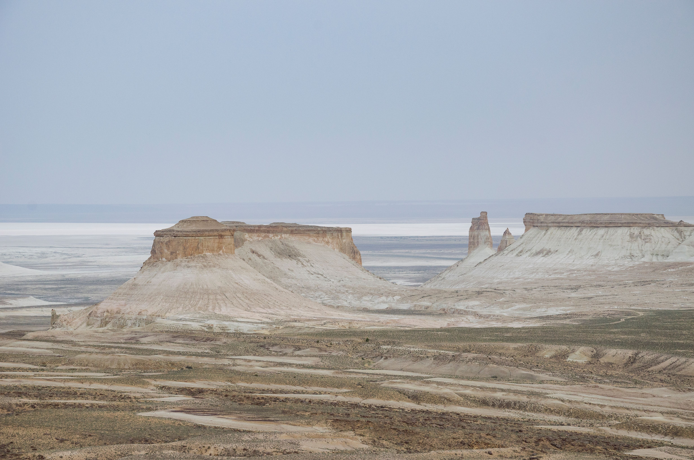

# Sample Book Title

<!--
This first line (one #) is ignored. It is only a label for you.
Read the tutorial below, then delete everything under this
comment and write your own book.
-->

## Start Here

### Welcome

This file is your book. Whatever you type here becomes the pages of your EPUB.

This short tutorial shows you how to write it. Each example shows **what you type**, then **what readers see**.

### Chapters and sections

Start a line with `##` and a space to make a **chapter**. Each chapter starts on a new page and appears in the table of contents.

Start a line with `###` and a space to make a **section** inside a chapter.

```markdown
## My First Chapter

### A Section

Your text goes here.
```

Leave an empty line between everything: headings, paragraphs, images, lists.

### Bold, italic and links

```markdown
This is **bold**, this is *italic*, and this is a [link](https://example.com).
```

This is **bold**, this is *italic*, and this is a [link](https://example.com).

### Lists

```markdown
- A bullet
- Another bullet

1. First step
2. Second step
```

- A bullet
- Another bullet

1. First step
2. Second step

### Quotes and dividers

```markdown
> Start a line with > to make a quote.


---
```

> Start a line with > to make a quote.


---

Three dashes make the dotted divider above.

## Adding Images

### Three steps

1. Copy your picture into the `images` folder (PNG or JPG).
2. Type a line like the one below. The words in the brackets become the caption.
3. Rebuild your book.

```markdown

```


Always put the image on its own line, with an empty line above and below. Want no caption? Leave the brackets empty: ``.

### Change the size or style

Add a word in curly braces right after the image:

```markdown
{.medium .frame}
```

{.medium .frame}

You can combine words, like `.medium` and `.frame` above. Here are all of them:

| Word | What it does |
|---|---|
| `.large` | Full width (default) |
| `.medium` | 80% width |
| `.small` | 60% width |
| `.tiny` | 35% width |
| `.portrait` | Narrower, good for phone screenshots |
| `.frame` | Adds a thin border |
| `.crop` | Fixed height, cropped to fill |
| `.icon` | Small round picture |
| `.cover` | Edge to edge, no rounded corners |

{.portrait}

{.crop}

Tip: use pictures with the same shape (for example all 16:9) so your book looks consistent.

## More Tools

### Tables

```markdown
| Food  | Calories |
|-------|----------|
| Apple | 95       |
| Rice  | 200      |
```

| Food  | Calories |
|-------|----------|
| Apple | 95       |
| Rice  | 200      |

### Footnotes

A footnote has two parts: a **marker** in your sentence, and the **note** itself. Readers tap the marker to see the note, and tap the arrow to go back.

```markdown
Put a marker in your sentence[^1].

[^1]: This is the note.
```

Put a marker in your sentence[^1]. You can add more[^2], and the numbers are added for you.

[^1]: This is the note. Tap the arrow to go back to the text.
[^2]: A second note. Write notes anywhere in the same chapter, usually at the end.

## Common Mistakes

### If something looks wrong

- **Heading not working?** You forgot the space: write `## Title`, not `##Title`.
- **Image missing?** Check the file name and that it is inside the `images` folder.
- **No caption or size?** Put empty lines above and below the image, and keep the image alone on its line.
- **Footnote showing as `[^1]`?** The note line `[^1]: ...` is missing, or it is in a different chapter (`##`). Marker and note must be in the same chapter.